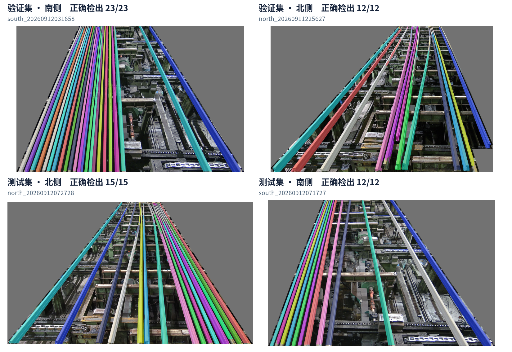
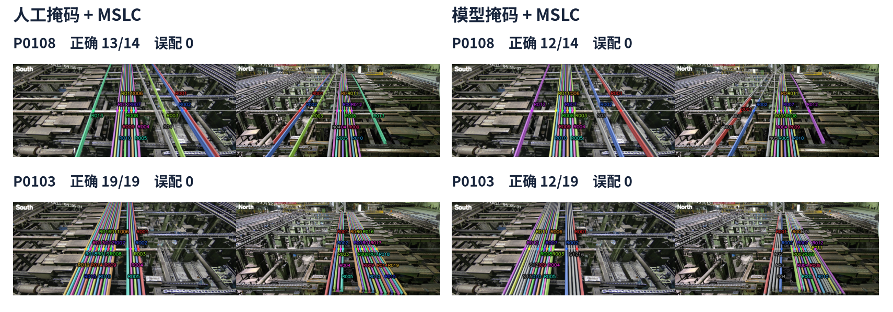
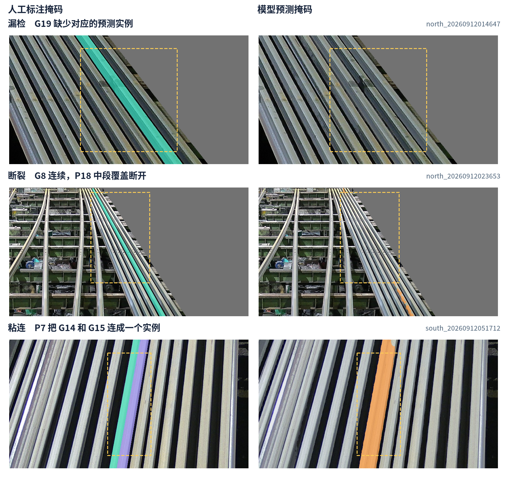
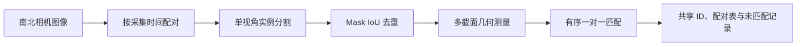

# 双视角钢轨实例分割与南北匹配

## 成果展示（自研双视角紧邻细长钢条分割算法与南北方向钢条匹配算法）

**实例分割：** 南北视角的验证集与测试集样例，彩色区域为逐根钢轨的预测掩码。



**跨相机匹配：** 对比人工掩码与模型掩码输入下的 MSLC 结果。每幅图对左南右北，同色同编号表示一条配对关系。



**典型误差：** 漏检、断裂和粘连，左列为人工标注掩码，右列为模型预测掩码。



## 项目目标与流程

系统输入同一次采集的南、北相机图像，输出逐根钢轨的实例掩码、南北配对关系、共享 ID 和未匹配记录。当前端到端流程采用 **YOLO26m-seg 三尺度基线、Mask IoU 去重和 MSLC 匹配**。



项目围绕三个问题展开：

- **数据处理：** 南北图像按文件名时间配对，两侧时间差最多 1 秒且须互为唯一候选；按采集组划分训练、验证和测试集，避免同一图对跨集合。训练数据提取有效作业区域，外围填灰后裁去灰边，并同步变换标注坐标。
- **实例分割：** 针对钢轨细长、远端窄小、相邻目标密集等特点，对比中心线辅助监督、Dice 损失和 P2 高分辨率分支。端到端推理支持直接分割原图，或由首遍预测掩码生成有效区域后再分割。
- **钢轨匹配：** 统一南北横向排序方向，利用位置、间距和轨束结构建立部分一对一关联，允许跳过漏检或仅单侧可见的实例。共享 ID 的作用域是当前图对。

本仓库展示项目源码、配置与精选结果图；原始数据及其标注、跨相机匹配真值、模型权重和完整实验产物不随仓库分发。

## 方法设计

### 单摄像头实例分割（提出中心线辅助loss以及修改网络增加低分辨率特征）

以 YOLO26m-seg 的 P3/P4/P5 三尺度模型为基线，分别检验几何监督、区域重叠约束与高分辨率特征对钢轨分割的作用。

| 方案 | 修改目的 | 原理与实现 |
| --- | --- | --- |
| 三尺度 + 中心线辅助监督 | 强化细长钢轨的中心结构表达，尝试缓解中段缺口和断裂。 | 从实例标注提取中心线并生成高斯热力图，在 Mask 原型上接轻量辅助头，以中心线 BCE 与原生分割损失联合训练。当前中心线权重为 0.05，方向、平滑和宽度监督关闭；辅助头只在训练时参与损失计算，推理仍使用原实例分割输出。[训练配置](config/train/train_rail_seg.yaml) · [辅助头与损失](core_algorithm/gas_rail/) |
| 三尺度 + 中心线辅助监督与 Dice 损失 | 在中心结构监督之外，直接约束实例区域重叠，尝试改善细窄前景的覆盖完整性。 | 保留中心线监督，在每个实例框内为原生掩码损失叠加 soft Dice 项，系数为 0.5，以预测掩码与真值的整体重叠补充逐像素约束。[实验配置](config/experiments/gas_center_dice.yaml) · [Dice 实现](core_algorithm/gas_rail/criterion.py) |
| YOLO26m-seg P2 四尺度 | 提高远端窄轨和小尺度钢轨的特征分辨率，检验增加浅层分支的收益。 | 在 P3/P4/P5 基础上增加 stride 4 的 P2 分支，融合上采样的 P3 与浅层 P2 特征；掩码原型由输入的 1/4 提升到 1/2 分辨率，新分支从 P3 权重热启动。[模型结构](config/model/yolo26m-seg-p2.yaml) · [权重迁移](data_preprocess/transfer_yolo26m_seg_p2.py) |

另以 SAM3 文本提示 `steel rail` 作为分割对照，配置与入口分别位于 [SAM3 预测配置](config/predict/sam3_predict.yaml) 和 [SAM3 实验模块](experiments/sam3_seg/)。

### 自研南北钢轨匹配

各算法接收同一图对的两侧逐实例掩码，利用有序约束求部分一对一匹配，并保留证据不足的未匹配或歧义记录。

| 算法与实现 | 算法全称 | 设计目的 | 核心原理 |
| --- | --- | --- | --- |
| [单截面基线](core_algorithm/matching/rail_matching.py) | 单截面有序一对一钢轨匹配 | 建立基于几何位置和间距的可解释基线，处理两侧实例数量不同的情况。 | 以 50% 高度截面中心为主位置，反向归一化南侧横坐标；用不对称三点间距生成仿射映射，在各映射下用允许跳过实例的有序动态规划求解，再以竞争映射共识和删边代价筛选配对。 |
| [MSLC](core_algorithm/matching/rail_matching_mslc.py) | Multi-Section Layout & Local Consensus Rail Matching<br>多截面结构分组与局部共识钢轨匹配 | 补充单截面证据，缓解竞争映射下整条路径严格共识造成的过度拒绝。 | 在 25%、50%、75% 三个截面分别生成候选映射与对齐路径，统计单条关联的截面支持率；结合稳定大间距布局、局部间距和中心线趋势，再以有序动态规划及删边裕度确定最终关系。 |
| [GMSA](core_algorithm/matching/rail_matching_gmsa.py) | Global Multi-Section Structural Alignment<br>全局多截面结构对齐 | 利用沿钢轨纵向变化的整体结构，处理重复排列、局部缺失和中间漏检。 | 在 10%–95% 高度的 18 个截面测量归一化间距与跨锚点跨度，通过受约束动态时间规整（DTW）比较跨度曲线，允许间距子序列合并；全局动态规划搜索有序锚点路径，以近优路径、方向共识和配对排除裕度判断可靠性。 |
| [ISA](core_algorithm/matching/rail_matching_isa.py) | Integer-Shift Alignment<br>整数错移对齐 | 显式处理近等距轨束的整列错位，探索减少 DTW 计算开销的匹配路线。 | 以整数错移和稳定大间隙生成少量映射假设，迭代执行单调动态规划与映射重估；分别比较更换伙伴、更换错移假设后的完整路径代价，利用配对裕度和假设裕度拒绝歧义。 |
| [CGM](core_algorithm/matching/rail_matching_cgm.py) | Chain-Graph Matching<br>链式图匹配 | 联合单轨、相邻钢轨与整束排列证据，检验图结构约束能否改善整列错位裁决。 | 以钢轨为节点、相邻间距为边，枚举整数错移并拟合映射；将节点位置与宽度、邻边间距和整束稳定大间隙一致性共同计入代价，使用链式动态规划与两类裕度完成判定。 |

## 实验结果

以下为项目阶段实验的历史实测结果。分割使用当时的 **57 张验证图和 28 张测试图**；更换数据或重新划分后，以重新生成的指标为准。

### 实例分割

| 方案 | 验证 Mask mAP50–95 | 测试 Mask mAP50–95 |
| --- | ---: | ---: |
| YOLO26m-seg 三尺度基线 | 62.23% | **69.34%** |
| 三尺度 + 中心线辅助监督 | 62.58% | 69.05% |
| 三尺度 + 中心线辅助监督与 Dice 损失 | **63.74%** | 68.56% |
| YOLO26m-seg P2 四尺度 | 41.07% | 48.80% |
| SAM3 文本提示 `steel rail` | 14.94% | 31.37% |

中心线与 Dice 组合在这组实验中取得最高验证指标，三尺度基线的测试指标最高；P2 增加分辨率后未取得指标提升。

### 跨相机匹配

五种算法使用同一批人工掩码，以 **33 对图像、486 条人工确认关系**评分。整对正确要求该图对的预测关系与真值完全一致。

| 算法 | 精确率 | 召回率 | F1 | 整对正确 |
| --- | ---: | ---: | ---: | ---: |
| 单截面基线 | 87.58% | 53.70% | 66.58% | 1/33 |
| MSLC | **94.70%** | **88.27%** | **91.37%** | **12/33** |
| GMSA | 93.87% | 69.34% | 79.76% | 5/33 |
| ISA | 81.43% | 58.64% | 68.18% | 2/33 |
| CGM | 84.50% | 67.28% | 74.91% | 2/33 |

MSLC 在这组真值评价中表现最好，作为当前 Demo 的匹配方法，其余算法保留用于对照。覆盖率和内部支持率用于描述算法输出及证据，配对正确性由人工真值评定。

### 从原图到匹配关系

采用三尺度基线与 MSLC，在同一批 **21 对验证图**上，以双侧掩码 IoU 0.50 评价关系是否正确：

| 推理方式 | 关系 F1 |
| --- | ---: |
| 原图单遍分割后匹配 | 44.05% |
| 首遍掩码生成有效区域后二遍分割与匹配 | **47.10%** |

## 代码组织

```text
annotation/          跨相机匹配真值标注工具
config/              数据、模型、训练、预测与评价配置
core_algorithm/      几何测量、辅助监督、掩码后处理与匹配算法
data_preprocess/     数据检查、格式转换、有效区域处理与权重迁移
experiments/         YOLO、SAM3 实验、算法对比与端到端 Demo
showcase/            精选分割、匹配与误差展示图
tests/               核心算法与数据处理测试
tools/               统一运行入口与本机 Git 工具
utils/               预测、评价、实验归档和绘图等公共工具
environment.yml      环境依赖清单
```

## 运行方式

### 环境与源码依赖

环境配置见 [environment.yml](environment.yml)，使用 Python 3.12.16、PyTorch 2.12.1+cu130 和 torchvision 0.27.1+cu130，需要支持 CUDA 13.0 的 NVIDIA GPU 环境。

环境文件以可编辑方式安装以下两套独立管理的源码，创建环境前需将对应版本放到项目根目录。

| 本地目录 | 源码来源 | 实验使用版本 |
| --- | --- | --- |
| `ultralytics_src/` | [Ultralytics](https://github.com/ultralytics/ultralytics) | 官方基准 `675c55692`，叠加本地 P2 验证补丁后的提交为 `9c69b49d7` |
| `sam3_src/` | [Meta SAM3](https://github.com/facebookresearch/sam3) | `f1647e8` |

Ultralytics 的本地补丁将验证时固定为 4 的掩码原型比例改为按模型最小 stride 推导：三尺度为 4，P2 四尺度为 2；复现 P2 需使用含该补丁的源码。

在项目根目录执行：

```console
conda env create -f environment.yml
conda activate rail
python -m pip check
python -c "import torch, torchvision; print(torch.__version__, torchvision.__version__, torch.version.cuda); print(torch.cuda.is_available())"
python -c "import ultralytics, sam3; print(ultralytics.__file__); print(sam3.__file__)"
```

Windows PowerShell 会话在运行前设置 UTF-8 与显存分配选项：

```powershell
chcp 65001 | Out-Null
[Console]::OutputEncoding = [Text.Encoding]::UTF8
$env:PYTHONUTF8 = "1"
$env:PYTHONIOENCODING = "utf-8"
$env:PYTORCH_CUDA_ALLOC_CONF = "expandable_segments:True"
```

Linux 终端在训练与推理前执行 `export PYTORCH_CUDA_ALLOC_CONF=expandable_segments:True`。

### 准备本地数据与权重

默认数据根目录为 `data/rail_data/`，可在 [数据路径配置](config/data/rail_data.yaml) 中修改 `dataset_path`，路径相对于项目根目录。两侧文件名使用 14 位采集时间 `YYYYMMDDHHMMSS`，训练和掩码评价需要同名 LabelMe JSON，每根钢轨标为一个 `rail` 多边形。

```text
data/rail_data/
├── south/
│   ├── YYYYMMDDHHMMSS.png
│   └── YYYYMMDDHHMMSS.json
└── north/
    ├── YYYYMMDDHHMMSS.png
    └── YYYYMMDDHHMMSS.json
```

YOLO 预训练权重放到 `pretrain_pt/yolo26m-seg.pt`，可在环境安装完成后下载：

```console
python -c "from ultralytics.utils.downloads import attempt_download_asset; print(attempt_download_asset('pretrain_pt/yolo26m-seg.pt'))"
```

运行 SAM3 对照时，从 [Meta SAM3 模型页](https://huggingface.co/facebook/sam3) 获取权重，放到 `pretrain_pt/sam3.pt`，并在 [SAM3 预测配置](config/predict/sam3_predict.yaml) 中设置提示词。

### 统一入口与数据处理

[tools/run_pipeline.py](tools/run_pipeline.py) 无参数运行时打开分组菜单，带阶段名时直接执行。Windows 也可双击 [run_pipeline.bat](tools/run_pipeline.bat)。

```console
python tools/run_pipeline.py --list-all
python tools/run_pipeline.py yolo-train -h
python tools/run_pipeline.py yolo-train --dry-run
```

首次生成训练数据，依次执行：

```console
python tools/run_pipeline.py check-data
python tools/run_pipeline.py yolo-data-export
python tools/run_pipeline.py bbox-export
```

数据导出使用 [有效区域配置](config/data/rail_roi.yaml)，生成填灰数据集 `data/clop_seg/` 和裁去外围灰边的数据集 `data/clop_seg_bbox/`。上游数据变更后按顺序重建，并给 `bbox-export` 加 `--refresh`。配对预览、成对标注导出和几何诊断可分别使用 `view-data`、`pair-export`、`geometry` 阶段。

### 分割训练与评价

默认 `yolo-train` 启用中心线辅助监督。训练三尺度基线时，复制 [默认训练配置](config/train/train_rail_seg.yaml) 为 `config/experiments/three_scale_baseline.yaml`，设置 `gas.enabled: false`，保持 `p2.enabled: false`，再通过 `--config` 指定。

```console
python tools/run_pipeline.py yolo-train --config config/experiments/three_scale_baseline.yaml
python tools/run_pipeline.py yolo-train
python tools/run_pipeline.py yolo-train --config config/experiments/gas_center_dice.yaml
python tools/run_pipeline.py p2-init
python tools/run_pipeline.py yolo-train --config config/experiments/p2_four_scale.yaml
```

P2 训练先执行 `p2-init` 生成热启动权重；复现表中的历史 P2 实验时，将其 [实验配置](config/experiments/p2_four_scale.yaml) 的顶层 `batch` 设为 `1`。

YOLO 每次训练在 `out/yolo_seg/` 下建立独立实验目录，保存配置、环境记录、训练曲线及最优权重，并自动执行独立验证和测试。以下 `RUN_DIR` 替换为本机实验目录，叠加图按需通过 `--overlays` 生成。

```console
python tools/run_pipeline.py yolo-valid --run "RUN_DIR" --overlays
python tools/run_pipeline.py yolo-test --run "RUN_DIR" --overlays
python tools/run_pipeline.py mask-analyze --run "RUN_DIR"
python tools/run_pipeline.py sam3-valid
python tools/run_pipeline.py sam3-test
python tools/run_pipeline.py seg-compare
```

YOLO 指标位于实验目录的 `valid/<时间戳>/metrics/evaluation.csv` 与 `test/<时间戳>/metrics/evaluation.csv`；SAM3 产物位于 `out/sam3_seg/`。`seg-compare` 对比已有独立验证结果；实验汇总使用 [报告清单](config/eval/experiment_report.yaml) 和 `seg-report` 阶段。

### 匹配对比与人工真值评价

准备好本地图像及 LabelMe 掩码后，运行五种匹配算法的统一对比：

```console
python tools/run_pipeline.py match-eval
```

结果位于 `out/evaluate_rail_match/<时间戳>/`，包含算法对比报告、配对表和几何诊断。首次可加 `--max-pairs 5` 抽样检查。

使用自己的数据建立跨相机匹配真值，再评价配对正确性：

```console
python tools/run_pipeline.py gt-manifest
python tools/run_pipeline.py gt-annotate --split valid
python tools/run_pipeline.py gt-annotate --split test
python tools/run_pipeline.py gt-export
python tools/run_pipeline.py gt-eval-algo
```

标注结果保存在本地 `data/rail_match_gt/`，真值评价写入 `out/rail_match_label/gt/<时间戳>/`。更换数据时，需同步检查 [真值配置](config/eval/rail_match_gt.yaml) 中的划分路径和历史排除项 `excluded_pairs`。

### 端到端 Demo

将 `WEIGHTS_FILE` 替换为训练得到的最优权重路径，分别运行原图单遍分割和预测有效区域二遍分割：

```console
python tools/run_pipeline.py rail-match-demo --weights "WEIGHTS_FILE" --limit 5
python tools/run_pipeline.py rail-match-demo --weights "WEIGHTS_FILE" --limit 5 --roi-mode predicted
```

已建立并复核本地匹配真值后，可对指定划分计算关系级指标：

```console
python tools/run_pipeline.py rail-match-demo --weights "WEIGHTS_FILE" --gt-split valid --limit 0 --roi-mode predicted
```

结果保存在 `out/rail_match_demo/<时间戳>/`，包含 `previews/`、`matches.csv` 和 `unmatched.csv`；指定 `--gt-split` 时另有 `relation_metrics.csv`。
