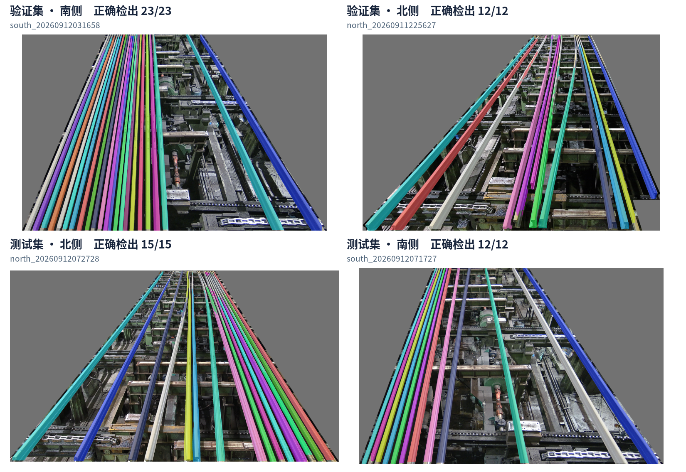
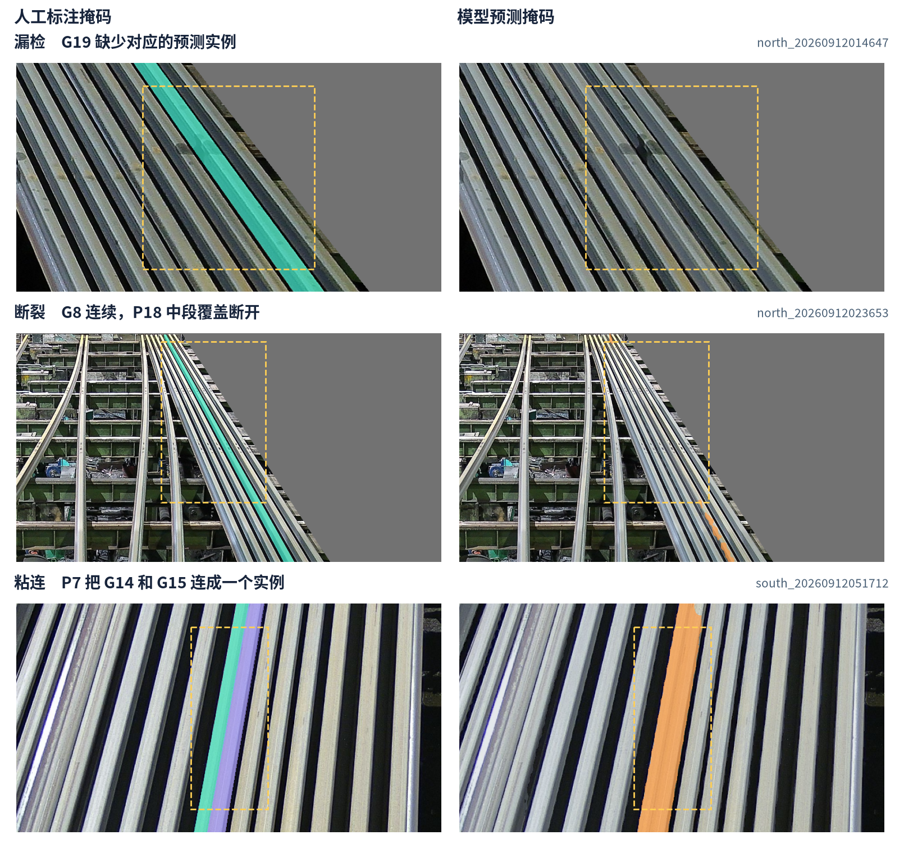
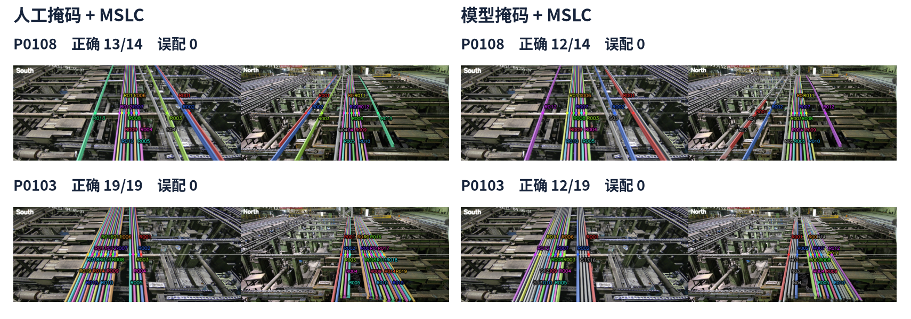

# 成果展示

以下三张图来自 v2.1 汇报使用的实验结果。

## 实例分割

四张南北视角样例覆盖验证集和测试集。彩色区域为模型输出的实例掩码，图上数字为正确检出数和标注实例数。

漏检、断裂和粘连三类典型错例。左列标出相关的人工掩码，右列显示对应的模型预测。

## 南北跨视角匹配

两组图对分别使用人工掩码和模型掩码运行 MSLC。每幅双栏图左南右北，同色同编号表示算法输出的一条配对。图中「正确」栏的分母为人工确认的关系总数。

